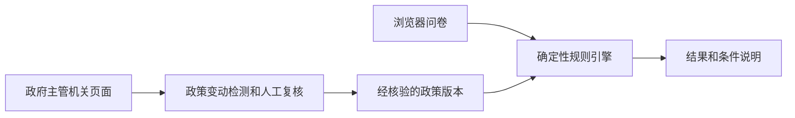

# 架构设计

## 应用与规则边界

Web 应用使用 Next.js 和 TypeScript。目录提供目的地及官方入口，问卷收集结构化条件，结果区将规则输出转换成中英文说明。用户输入以临时会话状态为默认。公开政策资料和问卷数据的生命周期彼此独立。

`src/domain/policy.ts` 接收结构化资料、政策版本和评估日期。相同的资料、版本和日期得到相同结果。比较函数区分 `0`、`false` 和未知。引擎检查核验状态、HTTPS 来源链接和日期，审核人负责确认政府发布者及证据内容。各项条件分别返回满足、缺口或未知，并附规则标识、版本、判断阶段和来源，由界面负责展示。已有明确缺口时保留缺口状态，并同时列出未知项。

首轮从 `src/data` 中受版本控制的规则快照加载已核验数据，规则引擎可独立测试。来源变动检查脚本独立运行，人工审核通过 Git 变更记录。数据库读取和审核管理端在后续阶段接入。

## 政策更新工作流

1. 为每个官方来源登记主管机关、URL、相关章节和适用日期。核验员保存判定所需的证据摘要。公开页面缺少规则生效日时保留未知，并说明原因。
2. 运行来源变动检查，对官方正文归一化后比较内容指纹。发生抓取失败或正文变化时，由人工开启审核事项。定期执行和自动建队列属于后续工作。
3. 核验员阅读变动前后的原文，补充生效范围、过渡安排、版本信息和边界测试。异常或无法核验的来源提交人工检查。
4. 审核通过后发布新版本，保留旧版本用于追溯。日期重叠需要明确区分适用场景。发布规则、测试用例及证据摘要应关联可审计的 Git 变更。
5. 发现录入错误时，可撤回有问题的版本或切换至仍然有效的前一版本。撤回理由和时间需保留。

## 部署和隐私边界

初版部署只需要运行 Web 应用。PostgreSQL 支持未来的政策目录持久化、审核记录和版本切换。将数据库放入受控网络，并为公开读取、规则导入和人工审核使用不同的访问权限。后端接入后避免将问卷、评估请求体、查询参数或可识别数据写入日志。

构建时锁定依赖并执行静态检查和规则测试。部署健康检查检验应用入口和规则来源链接展示。规则正文的变动检测、人工复核和网页可用性检查承担不同职责。
