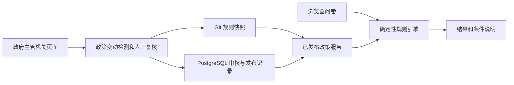

# 架构设计

## 应用与规则边界

Web 应用使用 Next.js 和 TypeScript。目录提供目的地及官方入口，问卷收集结构化条件，结果区将规则输出转换成中英文说明。用户输入以临时会话状态为默认。公开政策资料和问卷数据的生命周期彼此独立。

`src/domain/policy.ts` 接收结构化资料、政策版本和评估日期。相同的资料、版本和日期得到相同结果。比较函数区分 `0`、`false` 和未知。引擎检查核验状态、HTTPS 来源链接和日期，审核人负责确认政府发布者及证据内容。生效日包含在内，终止日排除在外。规则含有尚未生效、未核验或到期的来源时，该版本的结果仅供浏览。各项适用条件分别返回核对状态，并附规则标识、版本、判断阶段和来源。

旧版规则以条件列表表达全部必需项。新版本可通过条件标识组合 AND、OR、适用条件、例外和积分。适用范围或例外仍未知时，暂缓核对由它控制的条件。同一积分项出现多种档位时，只计入可适用的最高档。答案不足时，积分按已确认下限和可能上限表达，在两者都指向同一结论时才给出明确的门槛判断。

路径结果分别携带目标相关性、已核对条件的结论和仍待核实的完整资格。目录可展示待核验路径。个人结果仅显示有有效可用规则的路径。

政策内容来自受 Git 版本控制的 `src/data` 快照。正式生产环境读取 PostgreSQL 获批快照视图，并核对数据库指纹、存储快照和部署代码是否一致。服务器在页面打开时检查生效范围。新加坡 EP 采用新加坡当地日期，其余目前使用 UTC 日期。当前可用规则决定问卷显示哪些问题。来源变动检查脚本独立生成观察结果，发布和撤回由授权人员通过命令行完成。

网页、入审和审批使用不同数据库登录。入审与审批通过权限受限的函数写入状态和审计记录，操作者身份取自数据库会话。同一登录提交的快照须由其他授权登录批准。正式生产环境和完整规则的私人预览均从各自数据库加载获批快照。本地开发和自动化测试可使用 Git 快照。

## 政策更新工作流

1. 为每个官方来源登记主管机关、URL、相关章节和适用日期。核验员保存判定所需的证据摘要。公开页面缺少规则生效日时保留未知，并说明原因。
2. 运行来源变动检查，对官方正文归一化后比较内容指纹。发生抓取失败或正文变化时，由人工开启审核事项。定期执行和自动建队列属于后续工作。
3. 核验员阅读变动前后的原文，补充生效范围、过渡安排、版本信息和边界测试。异常或无法核验的来源提交人工检查。
4. 入审人员提交政策快照和证据，审批人员核对版本、指纹、适用日期和测试后批准。日期重叠需要明确区分适用场景。发布规则、测试用例及证据摘要应关联可审计的 Git 变更。
5. 发现录入错误时，可撤回有问题的版本或切换至仍然有效的前一版本。撤回理由和时间需保留。

## 部署和隐私边界

问卷核对继续在浏览器内运行。应用服务和 PostgreSQL 负责提供已发布政策，问卷答案无需传入该服务。生产环境缺少可用的已批准政策时，目录及官方链接仍可浏览。部署和本地预览的配置见测试说明。 [测试和部署](testing-deployment.md#web-部署)

私人预览通过受保护的 HTTPS 部署或连接回环地址的访问控制网关提供。认证覆盖页面和静态资源。问卷状态留在设备端。 [iPhone 私人预览](testing-deployment.md#iphone-私人预览)

构建时锁定依赖并执行静态检查和规则测试。部署健康检查检验应用入口和规则来源链接展示。规则正文的变动检测、人工复核和网页可用性检查承担不同职责。
